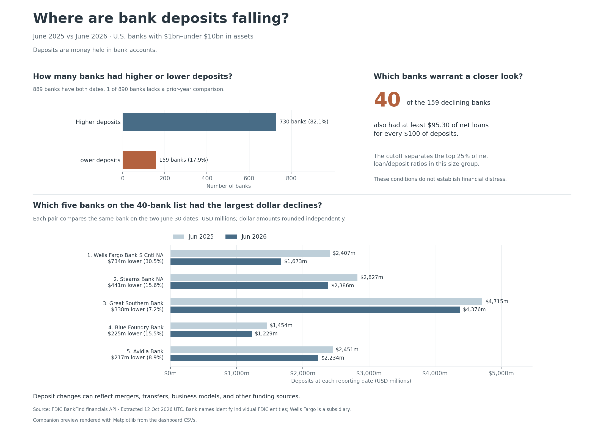

# Bank Funding Monitor

Bank Funding Monitor analyzes quarterly FDIC bank financial data to identify banks with falling deposits and relatively high lending ratios. It connects API extraction, data cleaning, a relational SQL database, exploratory analysis, and a Tableau dashboard in one reproducible project.

The business question is: **which banks in a comparable asset range warrant closer funding analysis?** The output is an explainable review queue, ranked by the size of each bank's reported deposit decline.

*Static companion preview rendered with Matplotlib from the same CSVs used by the Tableau workbook.*

## Data and scope

The saved dataset contains **67,451 bank-quarter records across 4,729 banking entities and 15 quarters**, from December 31, 2022 through June 30, 2026. It was retrieved from the [FDIC BankFind financials API](https://api.fdic.gov/banks/docs/) on October 12, 2026.

The analysis compares banks with **$1 billion to under $10 billion in assets** at each reporting date. The June 2026 peer group contains 890 banks; 889 have a valid prior-year deposit comparison. Each bank is identified by its FDIC certificate, so the analysis concerns individual banking entities rather than consolidated holding companies.

## Results: June 2026

| Measure | Result |
|---|---:|
| Banks with higher deposits than June 2025 | 730 of 889 · 82.1% |
| Banks with lower deposits | 159 of 889 · 17.9% |
| Median year-over-year deposit growth | 5.07% |
| Peer 75th-percentile net-loan/deposit ratio | 95.30% |
| Banks meeting the joint review rule | 40 · 4.5% of eligible banks |
| Gross deposit decline within the review queue | $3.325 billion |
| Share of all peer deposit declines attributable to the ten largest declines | 50.45% |

The **review rule** combines negative year-over-year deposit growth with a net-loan/deposit ratio at or above the same-quarter peer group's 75th percentile. The percentile is an analytical threshold, not a regulatory limit. Deposit declines are changes in reported balances, not lost revenue or confirmed customer withdrawals.

## Tools and technologies

| Tool or technology | Specific role in the project |
|---|---|
| **Python** | Coordinates extraction, cleaning, database creation, analysis, exports, workbook generation, and validation. |
| **FDIC BankFind REST API** | Supplies public quarterly financial records. Python's `urllib` handles HTTP requests, pagination, timeouts, and bounded retries. |
| **pandas** | Parses dates and financial fields, validates records, defines peer groups, calculates percentile thresholds, and produces CSV outputs. |
| **NumPy** | Supports peer segmentation, missing-value handling, and ranking in the analytical outputs. |
| **SQLite and SQL** | Store bank and period dimensions, financial facts, source provenance, and peer signals. SQL joins calculate exact prior-year comparisons and financial ratios; business queries use CTEs and window functions. |
| **Tableau workbook format and Tableau Hyper API** | Provide the packaged dashboard and embedded extracts. Python's `xml.etree.ElementTree` generates the `.twb` workbook; `tableauhyperapi` creates the `.hyper` data sources; `zipfile` assembles the `.twbx` package. |
| **Matplotlib** | Renders the static dashboard preview shown above. |
| **Python unittest, hashlib, and sqlite3** | Check boundary cases, source checksums, relational integrity, SQL/CSV agreement, and repeatable output. |
| **Git and GitHub** | Version control and publication of the source code, data snapshot, reports, and dashboard assets. |

The Python dependencies are recorded in [requirements.txt](requirements.txt). The Tableau workbook was generated programmatically; the preview is a separate Matplotlib rendering.

## Implementation

1. **Extraction:** original API responses and a raw CSV are retained with request URLs, retrieval time, per-quarter counts, and SHA-256 checksums.
2. **Cleaning:** identifiers, quarter-end dates, text labels, and integer financial values are validated. Duplicate bank-quarter keys and invalid values fail validation. Nulls remain distinct from zero; valid extreme observations are retained.
3. **Database modeling:** `dim_bank`, `dim_period`, `fact_financials`, and `pipeline_run` preserve the bank-quarter grain and source lineage. `fact_peer_signals` stores the analytical flags.
4. **Financial calculations:** the SQL view matches the same bank to the exact prior-year quarter. It calculates deposit growth, net loans/deposits, cash/deposits, and equity/assets with protected denominators.
5. **Exploratory analysis:** peer segmentation, median-absolute-deviation outlier scores, deposit-decline concentration, and P70/P75/P80/P90 sensitivity provide context for the review rule.
6. **Presentation:** CSV exports feed two dashboard views: counts of banks with rising or falling deposits, and paired June 2025/June 2026 balances for the five largest dollar declines within the review queue.

## Project contents

| File or directory | Contents |
|---|---|
| [pipeline.py](pipeline.py), [src/](src/) | Extraction, transformation, database loading, and analysis |
| [config.json](config.json) | API fields, reporting range, peer boundaries, and analytical thresholds |
| [sql/](sql/) | Database schema, metric views, and business queries |
| [data/raw/](data/raw/) | Original JSON responses, raw CSV, and source manifest |
| [data/processed/](data/processed/) | Cleaned records, peer metrics, review queue, trends, and sensitivity results |
| [bank_funding.sqlite](data/warehouse/bank_funding.sqlite) | Populated relational database |
| [Bank_Funding_Monitor.twbx](tableau/Bank_Funding_Monitor.twbx) | Packaged Tableau dashboard with two embedded Hyper extracts |
| [build_dashboard.py](build_dashboard.py) | Tableau workbook, extract, and preview generation |
| [BUSINESS_MEMO.md](reports/BUSINESS_MEMO.md) | Findings, ranked observations, and threshold sensitivity |
| [docs/](docs/) | Data definitions, dashboard interpretation, and workbook specifications |
| [tests/](tests/), [reports/validation.json](reports/validation.json) | Automated checks and recorded validation results |

## Validation and analytical limits

The project includes 14 automated tests covering invalid inputs, missing history, zero denominators, relational integrity, source reconciliation, and agreement between SQL and CSV results. Rebuilding the saved snapshot produces identical processed CSVs. Both embedded Hyper extracts were reopened and reconciled against their source CSV values. Workbook checks cover packaging and targeted XML constraints; native Tableau Desktop/Public opening and rendering have not been verified.

Peer membership changes over time, and asset size alone does not capture differences in business models. Mergers, transfers, and other funding sources can affect deposit balances. The data support comparative screening, but do not establish distress, causation, predictive accuracy, or measured business impact.

Code and documentation are MIT licensed. Public source data remain attributed to the FDIC.
